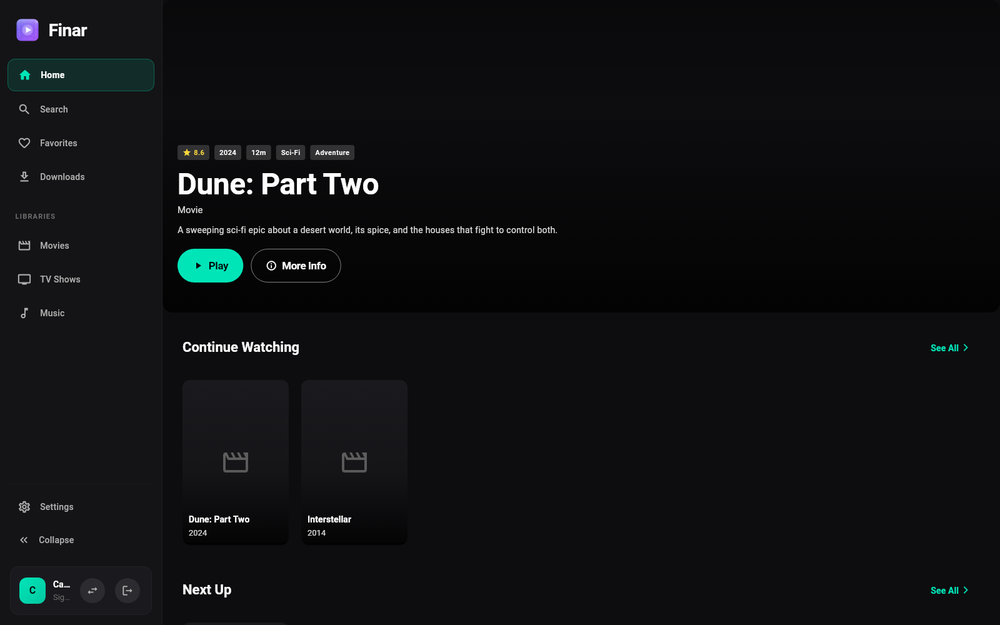
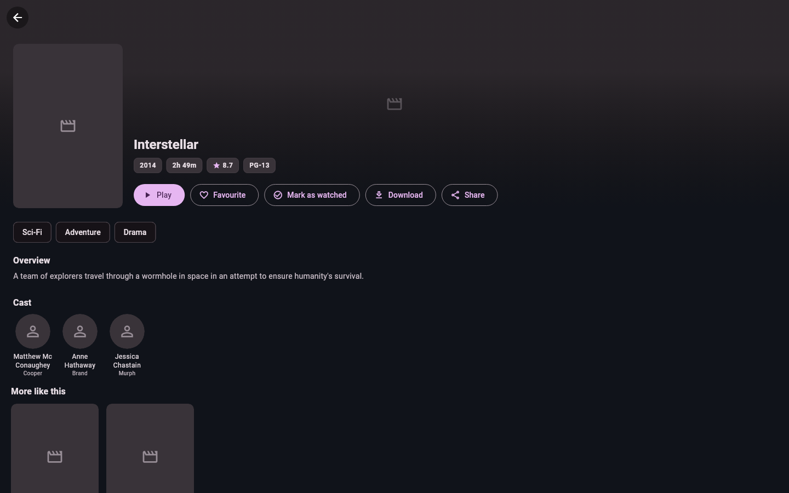
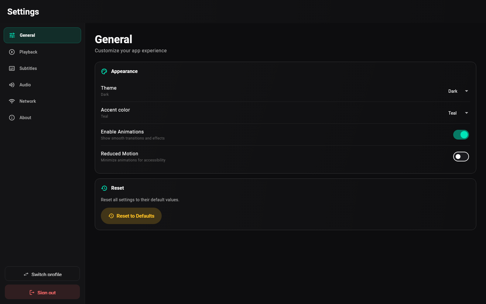

# Finar

A modern Jellyfin client for Android, iOS, Linux, Windows, macOS and the web.

[](https://gitlab.com/openlyst/finar/-/pipelines)
[](https://gitlab.com/openlyst/finar/-/releases)
[](https://gitlab.com/openlyst/finar/-/blob/main/LICENSE)

**[Landing page](https://openlyst.gitlab.io/finar/)** | **[Releases](https://gitlab.com/openlyst/finar/-/releases)**

## What it does

Finar connects to your Jellyfin server and puts your media front and centre.

- Sign in with a password or Quick Connect, and keep multiple profiles around
- Continue watching, next up and the latest additions on the home page
- Browse libraries with sorting, watch-state filters and genre filtering
- Direct-play video and music with subtitle and audio track selection, playback speed and server-side progress reporting
- Download media for offline playback
- Custom macOS-style window chrome on desktop, a wide row-list sidebar, and a touch-friendly layout on mobile
- Light, dark and OLED themes with accent colours, in four languages

## Install

Get the latest build for your platform from **[Releases](https://gitlab.com/openlyst/finar/-/releases)**.

- **Android**: `.apk` or `.aab`
- **iOS**: unsigned `.ipa`, side-loadable through the [AltStore source](https://gitlab.com/openlyst/finar/-/raw/main/repos/altstore.json)
- **Linux**: `.deb`, `.rpm`, `.AppImage` or plain `.zip` (x64 and arm64)
- **Windows**: installer `.exe` or `.zip`
- **macOS**: unsigned `.zip`
- **Web**: hosted at the landing page under `/app/`

## Screenshots





## Docker

A self-hosted web build is available via `docker/`:

```bash
docker compose up -d
```

Set `JELLYFIN_URL` to pre-fill your server address.
